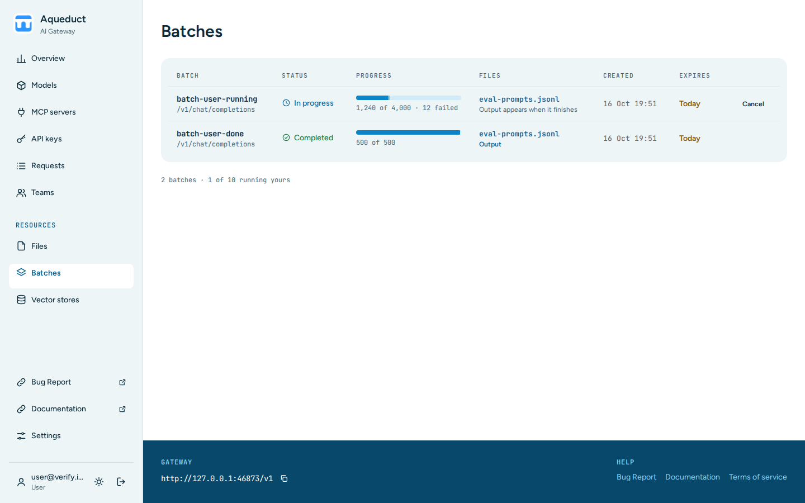

# Batches

The Batches page lists the batch jobs that your keys created through the [Batches API](../api/batches.md). A batch runs the requests of an uploaded JSON Lines (`.jsonl`) file. Choose **Batches** under **Resources** in the sidebar.

The table lists the batches of your personal keys and of your teams' service accounts. Org admins see the batches of every key in their organization, and admins see those of the organization chosen in the sidebar, or of every organization. The newest batches come first, 50 per page. Choose **Next** and **Previous** under the table to move between pages. Cancelling a batch keeps you on the same page. Each row shows:

- **Batch**: the batch ID and the API endpoint its requests call. A batch that is not yours also shows its team, or the email of the user who created it.
- **Status**: the state of the batch, such as **Validating**, **In progress**, **Completed**, **Failed**, or **Cancelled**. While a batch runs, **Finish by** shows when it must finish. A batch that has not finished by then expires.
- **Progress**: a bar with the processed and total requests and the number of failed requests.
- **Files**: the input file, and links to the output and error files when they exist. A running batch shows **Output pending**. A file name opens the [Files](files.md) page that holds its row.
- **Created**: when the batch was created.

The line under the table counts running batches against the limits for your keys and for each team you belong to, as in `Running: you 1/10 · Verify Team 1/25`. Validating, in-progress and cancelling batches count toward these limits.

## Cancel a batch

You can cancel a validating, in-progress, or finalizing batch that your personal keys created. Other batches are view-only. Choose the cancel button in the batch's row, then choose **Cancel batch**. Requests that the batch has not run yet are dropped.

To cancel a service account's batch, use the [Batches API](../api/batches.md) with the service account key.
