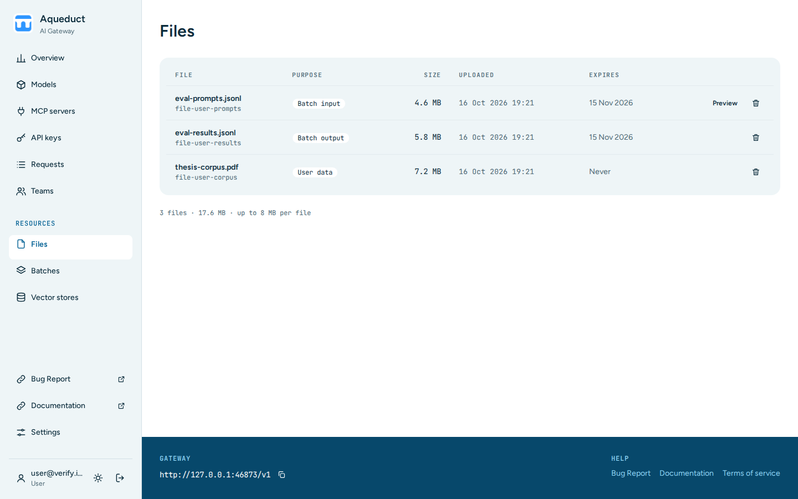

# Files

The Files page lists the files that your keys uploaded through the [Files API](../api/files.md). Choose **Files** under **Resources** in the sidebar.

The table lists the files of your personal keys and of your teams' service accounts, newest first, 50 per page. Choose **Next** and **Previous** under the table to move between pages. Deleting a file keeps you on the same page. A team's file shows the team name after its ID. Each row shows:

- **File**: the file name and ID.
- **Purpose**: what the file is for, such as `batch`.
- **Size**: the file size.
- **Uploaded**: when the file was uploaded.
- **Expires**: when Aqueduct deletes the file.

The line under the table shows the number of files on all pages, their total size, and the maximum size per file.

## Preview a file

Choose **Preview** to show the first lines of a file. Only files with a stored preview, such as batch input files, have this button. Choose **Close** to hide the preview.

## Delete a file

You can delete files that your personal keys uploaded:

1. Choose the delete button in the file's row.
2. Choose **Delete file**.

Aqueduct deletes the file at the provider first. If that fails, Aqueduct keeps the file. To delete a service account's file, use the Files API with the service account key.

To upload a file, use the [Files API](../api/files.md).
