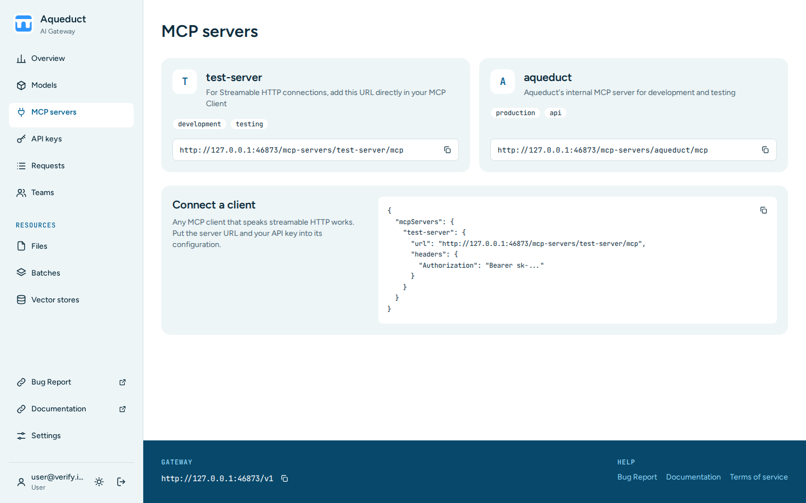

# MCP servers

The MCP servers page lists the Model Context Protocol (MCP) servers that Aqueduct relays. An MCP server gives an AI client tools, such as search or database access. Choose **MCP servers** in the sidebar.



## Read a server card

Each card shows:

- The server name. Use this exact name in the server URL.
- A description and tags.
- The server URL on this gateway, with a copy button.

The URL has this form:

```
https://your-aqueduct-domain.com/mcp-servers/<server-name>/mcp
```

A server that is switched off for some of your keys shows a badge such as `Off for Verify Team`, as on the [Models](models.md#check-where-a-model-is-available) page. A request to a switched-off server returns `404`.

## Connect a client

1. Copy the server URL from its card.
2. Configure your MCP client with the URL, and send your API key as a bearer token in the `Authorization` header.

The **Connect a client** card shows a client configuration for the first server, with a copy button. Replace `sk-...` with your API key.

For the API details, see the [MCP API reference](../api/mcp.md).
