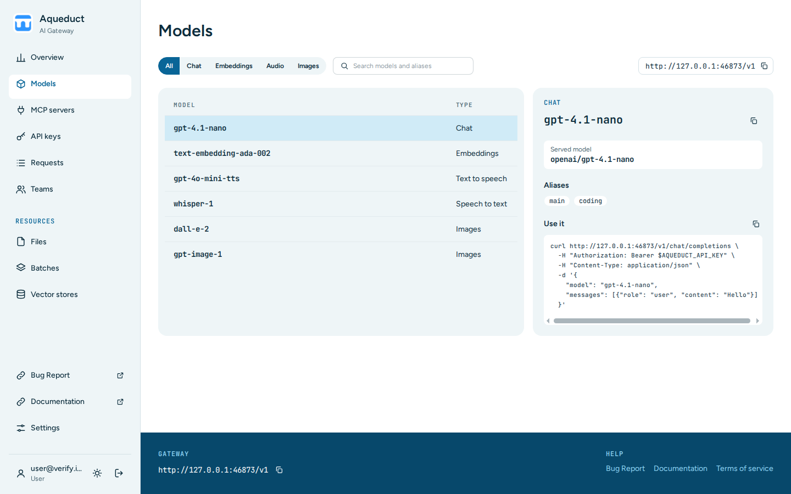

# Models
{: .no_toc }

## Table of contents
{: .no_toc .text-delta }

1. TOC
{:toc}

---

The Models page lists every model of the gateway and shows how to call it. Choose **Models** in the sidebar.

## Find a model

The table lists each model with its type, such as **Chat**, **Embeddings**, **Text to speech**, **Speech to text**, or **Images**. A short description is under the model name when the admin wrote one, and a badge next to the name shows the quantization of the model weights, such as `FP8` or `AWQ`. When the gateway knows them, the table also shows:

- **Aliases**, other names that you can send for the model. On a narrow screen, they are under the model name.
- **Context**, the context length, such as `262.1K`. For a chat model, this is the input and output tokens of one request together. For an embedding model, it is the maximum input tokens.

- To show one type, choose its tab above the table.
- To find a model by name or alias, type in **Search models and aliases** and press Enter.

## Read a model's details

Choose a model to show its details. On a wide screen they show in a panel on the right. On a narrower screen they open in the table under the model. The details show:

- The model name. Use this name in the `model` parameter of your requests.
- The description of the model, when the admin wrote one.
- **Model card**, a link to the model's page, usually on Hugging Face. It opens in a new tab.
- **Quantization**, **Context length**, and **Max output tokens**, with full numbers, when the admin configured them. An embedding model shows **Max input tokens** instead of the context length.
- Other specs the gateway knows, such as the embedding dimensions and the input and output types.
- **Served model**, the upstream model that answers the requests. Only org admins and admins see it.
- **Aliases**, other names for the same model, when it has any.
- **Capabilities**, such as vision, tools, or reasoning, and a higher request limit when the model has one.
- **Use it**, a `curl` command for the model's endpoint, with a copy button. It reads your API key from `$OPENAI_API_KEY`.
- **Usage** and **Requests**, which open the [Overview](usage.md) and the [Requests](requests.md) page for the model.

A model with a retirement date carries a **Deprecated** badge, and its panel shows the date. Move to another model before that date.

## Use an alias

You can send an alias instead of the model name in the `model` parameter. The model behind an alias can change, for example when a newer version replaces it. Your requests keep working without a change.

## Check which keys can use a model

The page lists only the models that at least one of your keys can use: your personal keys, or the service accounts of a team you are in. Admins can make a model unavailable for an organization, a team, or a single user. The page then leaves it out, as `/v1/models` does for a key.

When only some of your keys can use a model, the panel names them, for example `Available with your personal keys.` A request with another key returns `404`.

To get a model you do not see, ask an admin. See [Model availability](admin.md#model-availability).
