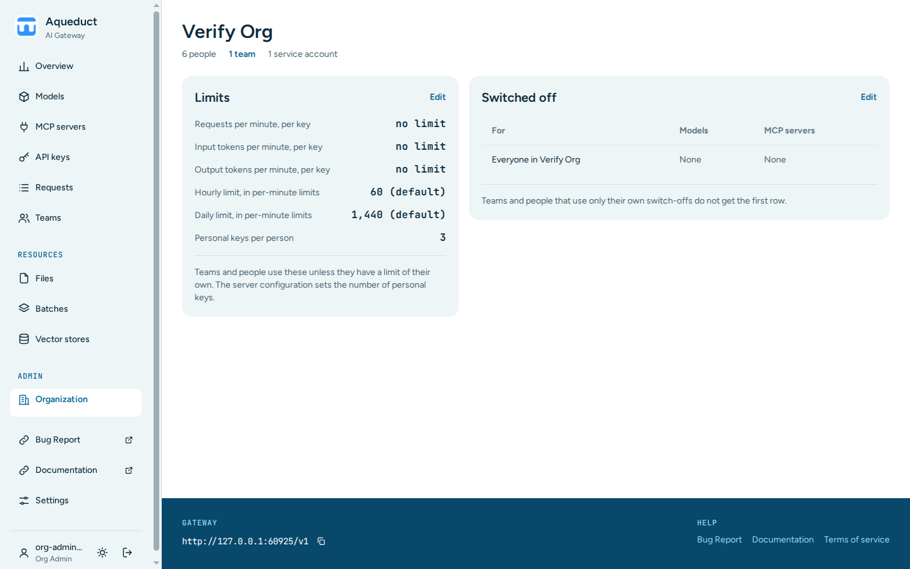

# Organization
{: .no_toc }

## Table of contents
{: .no_toc .text-delta }

1. TOC
{:toc}

---

The Organization page shows the default limits of your organization and what is switched off in it. Org admins and admins edit both here. Choose **Organization** under **Admin** in the sidebar.

Only org admins of the organization and admins see this page. Other users who open it are sent to the [Teams](teams.md) page.

## Read the page

The top of the page shows the number of people, teams, and service accounts in the organization. The team count opens the Teams page.

- **Limits** shows the default limits for each key in the organization. Teams and people use these limits unless they have limits of their own. **Personal keys per person** comes from the server configuration and cannot be changed here.
- **Switched off** shows the models and MCP servers that are switched off for everyone in the organization, and for each team that switches off something of its own. A team name opens its team page.

Admins see the organization they chose in the sidebar. See [Choose an organization](index.md#choose-an-organization).

## Change the limits

1. Choose **Edit** on the **Limits** card.
2. Set the limits:
    - **Requests per minute, per key**, **Input tokens per minute, per key**, and **Output tokens per minute, per key**. Leave a field empty for no limit.
    - **Hourly limit, in per-minute limits**, from 1 to 60, and **Daily limit, in per-minute limits**, from 1 to 1440. For example, an hourly value of 30 allows 30 times the per-minute limit in one hour. Leave a field empty for the server default.
3. Choose **Save changes**.

The **Edit** link next to the default limit on the Teams page opens the same form.

If a request goes over a limit, the API answers with HTTP status `429 Too Many Requests`.

## Switch off models and MCP servers

1. Choose **Edit** on the **Switched off** card.
2. Select the models under **Switched off models** and the servers under **Switched off MCP servers**.
3. Optional: clear **Also switch off the server's default models** or **Also switch off the server's default MCP servers**. The server configuration can switch off models and MCP servers everywhere. Clear the box to make them available in this organization.
4. Choose **Save changes**.

A request to a switched-off model or MCP server returns `404`. The [Models](models.md) and [MCP servers](mcp-servers.md) pages show where each one is switched off.

The form lists only the models and MCP servers of the current configuration. A stored switch-off that the configuration no longer has shows as a selected box labelled `(not in the current config, kept)`. Saving keeps it. Clear the box to remove it.

Team and user switch-offs are still edited in the Admin panel. See [Excluding Models](admin.md#excluding-models).
