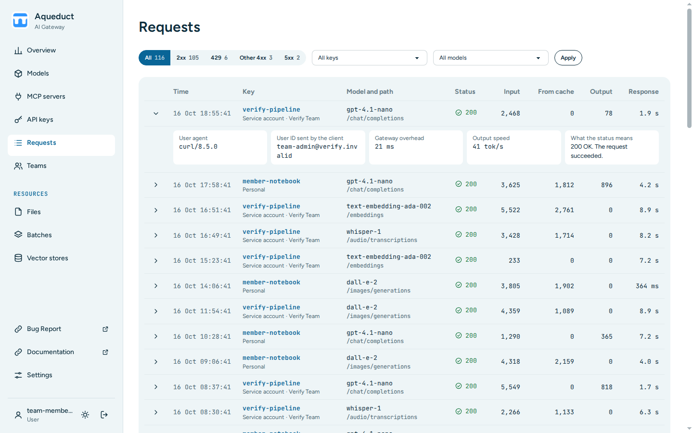

# Requests
{: .no_toc }

## Table of contents
{: .no_toc .text-delta }

1. TOC
{:toc}

---

The Requests page is the log of single API requests, newest first. Use it to find out why a request failed or how long it took. Choose **Requests** in the sidebar.

## Whose requests you see

You see the same requests as on the [Overview](usage.md) page:

- Users see the requests of their own keys and of their teams' service accounts. A request that another person's key sent with your e-mail address as [`user_id`](../api/index.md#sending-user_id-in-api-requests) stays that person's request.
- Org admins see every request of their organization.
- Admins see the organization they chose in the sidebar, or all organizations. See [Choose an organization](index.md#choose-an-organization).

The log lists only requests to models that the gateway still serves.

## Read a request

Each row shows the time, the key, the model and the API path, the status code, the input tokens, the input tokens from cache, the output tokens, and the response time.

Choose a model name to show only that model. Choose a row, or the arrow at its start, to show its details. Choose it again to hide them.

- **Request ID**: the number Aqueduct stores the request under. The copy button copies it.
- **User agent**: the client that sent the request.
- **User ID sent by the client**: the `user_id` value, if the client sent one.
- **Gateway overhead**: the time Aqueduct added to the provider's response time.
- **Output speed**: the output tokens per second.
- **What the status means**: the status code in plain words.

## Filter the log

- To show one kind of status, choose a tab: **All**, **Failed**, **2xx**, **429**, **Other 4xx**, or **5xx**. **Failed** holds every `4xx` and `5xx` request. Each tab shows its count.
- The log has the same filters as the [Overview](usage.md) page: the organization, the key, **All models**, and the time frame. The log opens on **30 days**.
- On the Overview page, **Open the log**, a status group, and a model open the log with the same filters.

## Search the log

Type in the search field above the table and choose **Search**. The log then shows only the requests that match:

- A request ID matches that one request.
- Other text matches a request whose path, user ID sent by the client, or user agent contains the text. Upper and lower case are the same.

The search applies inside the filters, the status tab, and the time frame that you chose. The tab counts and the line under the table count the matching requests. Choose **Clear** to remove the search.

A search reads every request that the filters allow. Over 30 days of a large organization, it can take some seconds. To make it faster, choose a shorter time frame, a key, or a model.

## Sort the log

The log opens with the newest request first. To sort by a column, choose its heading: **Time**, **Model**, **Status**, **Tokens**, or **Response**. Choose the heading again to sort in the other direction. An arrow shows the column and the direction of the sort.

- **Tokens** sorts by the total of input and output tokens.
- **Status** puts the highest status codes first.
- Requests without a response time or a status code come last.

You can always sort by **Time**. The other columns sort only a selection of 7 days or less, one key, or one model. Users and team admins can sort their requests over all 30 days. Over all of an organization for 30 days, the other headings show a hint and do not sort.

## Move between pages

The log shows 50 requests per page. Choose **First**, **Previous**, **Next**, or **Last** to move between pages. The line under the table shows the position of the page, for example `51–100 of 2,480`. A link to one request, such as the links on a key's page, opens the page that holds it. That page shows only the number of requests until you choose **First** or **Last**, or reach the end of the log.

The counts under the tabs and the table are kept for one minute. Move between pages, sort, or open a request, and the counts stay the same. Choose another filter or time frame to count again.

## How long requests are kept

The line under the table shows how many days Aqueduct keeps requests. The default is 30 days. Aqueduct deletes older requests once a day, and the Overview page cannot show them either. Your deployment sets the number of days with the `REQUEST_RETENTION_DAYS` environment variable.
