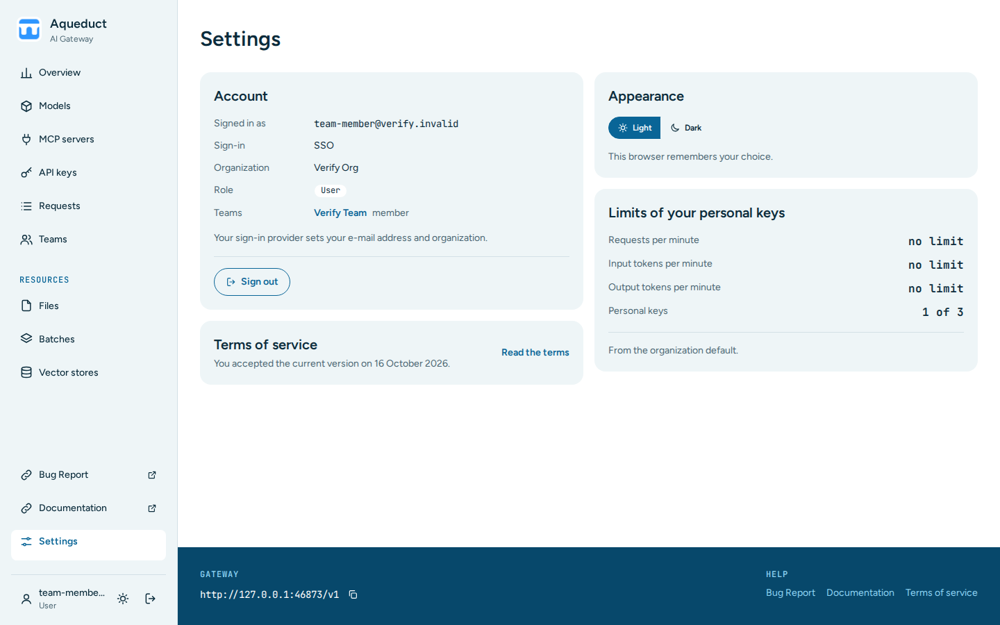

# Settings

The Settings page shows your account and the limits of your personal keys. Choose **Settings** at the bottom of the sidebar.

The page has these sections:

- **Account** shows the e-mail address you signed in with, the sign-in provider, your organization, your role, and each team you are in with your role there. A team name opens its [team page](teams.md). **Sign out** signs you out.
- **Terms of service** shows when you accepted the current terms. **Read the terms** opens them. This section appears only when your deployment uses terms of service.
- **Appearance** switches between **Light** and **Dark**. Your browser stores the choice, so it applies only in this browser.
- **Limits of your personal keys** shows the requests, input tokens, and output tokens per minute that each personal key may use, and how many personal keys you have out of 3. The note under the limits says whether an admin set limits for your account or the organization default applies.

Your sign-in provider sets your e-mail address and organization, so you cannot change them here. Admins change account limits in the Admin panel. See [Managing User Limits](admin.md#managing-user-limits).
