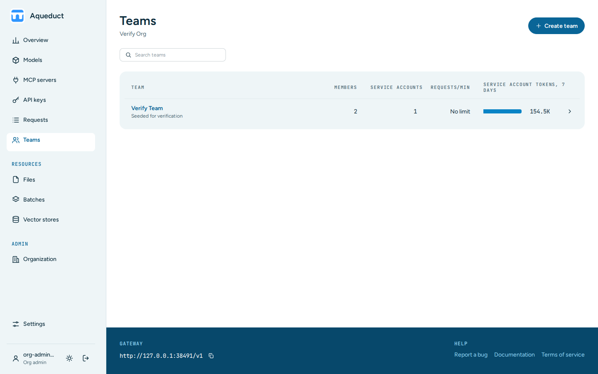
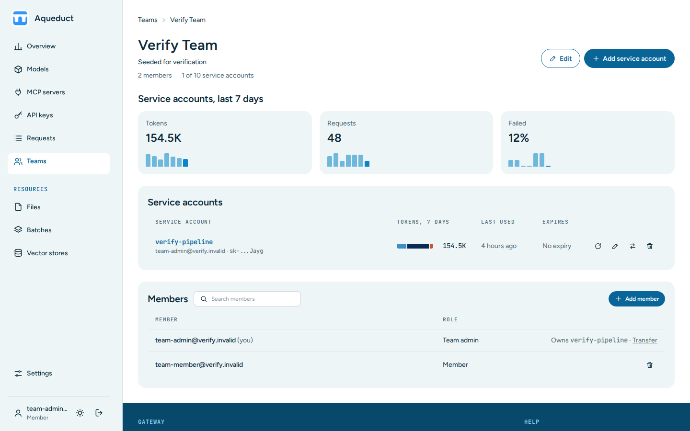

# Teams
{: .no_toc }

## Table of contents
{: .no_toc .text-delta }

1. TOC
{:toc}

---

A team groups users of an organization and owns service accounts. A service account has one API key that belongs to the team instead of to a person, for example for a pipeline or a shared application.

## Read the team list

Choose **Teams** in the sidebar.

Users see the teams they are a member of. A **Team admin** badge marks the teams they manage. Users in no team see a note to ask their org admin. Org admins see every team of their organization. Admins see the organization they chose in the sidebar. With **All organizations**, they see the teams of every organization, with an **Organization** column. See [Choose an organization](index.md#choose-an-organization).

Each row shows the number of members and service accounts, the team's **Requests/min** limit, and the tokens of the team's service accounts over the last seven days. Members' personal keys do not count. On a narrow screen, each row shows the team name and these figures on one line. The search box filters by team name. The list shows 50 teams per page. Choose **Next** and **Previous** below the table to see the others.

If a request goes over a limit, the API answers with HTTP status `429 Too Many Requests`.

## Create or delete a team

Org admins and admins manage teams:

1. Choose **Create team** on the Teams page.
2. Enter a **Name** and, optionally, a **Description**.
3. Choose **Create team**.

Admins create the team in the organization they chose in the sidebar. The form names that organization.

To delete a team, open it, choose **Edit**, then choose **Delete team** at the bottom of the page and confirm. Its service accounts are deleted with their keys and everything the keys created. Members keep their personal keys.

## Open a team

Choose a team's name to open its page. The page shows:

- The number of members and service accounts. Team admins also see the maximum of 10 service accounts.
- **Service accounts, last 7 days**, with the tokens, requests, and share of failed requests of the team's service accounts.
- **Service accounts**, with each owner, tokens, last use, and expiry. Hover over a token bar to see the cached input, new input, and output.
- **Members**, with each member's role. Team admins come first, then the other members by email, 50 per page. The search box next to **Members** filters by email.
- **Limits**, with the rate limits of each service account key. The card is hidden when the team has no limit, except for org admins and admins. They also see the models and MCP servers that are unavailable to the team, when there are any.

The team figures count only service account keys. Members' personal keys follow their own limits and do not count toward the team.

Team admins and org admins choose **Edit** to change the team's name and description.

## Manage service accounts

Team admins and org admins manage service accounts on the team page.

To add a service account:

1. Choose **Add service account**.
2. Enter a **Name** and, optionally, a **Description** and an **Expires** date in UTC.
3. Choose **Create service account**.

The **Your key is ready** panel shows the new key once. Copy it now. You become the owner of the service account.

The buttons at the end of each service account row are:

- **Rotate** replaces the key and shows the new one in the **Your key is ready** panel. The old key stops working immediately.
- **Edit** changes the name, the description, or the key expiry.
- **Transfer** gives the service account to another team member. Choose the **New owner** from the list, then choose **Transfer ownership**. In a team of more than 50 members, enter the new owner's email instead. The key keeps working.
- **Delete** deletes the service account and its key after you confirm.

## Manage members

Team admins and org admins manage members:

- To add a member, choose **Add member**, enter the person's email, and choose **Add**. The person must belong to the team's organization. Upper and lower case do not matter.
- To remove a member, choose the delete button in the member's row, then **Remove**. A member who owns a service account of the team cannot be removed. Their row shows **Owns** with the service account's name and a **Transfer** link. Transfer the service account first.

Org admins and admins also appoint team admins. Choose **Make admin** in a member's row. **Remove admin** takes the role away. Team admins cannot appoint other team admins.

## Limits and model availability

Org admins and admins set the team's limits. Choose **Edit** next to **Limits** on the team page, or **Edit** at the top of the page. Enter the **Requests per minute**, **Input tokens per minute**, and **Output tokens per minute** of each service account key, then choose **Save changes**. Leave a field empty to use the organization's limit. Team admins edit the team's name and description in the same form, without the limits.

Org admins and admins choose the models and MCP servers that the team's service accounts can use. Choose **Edit** under **Unavailable to service accounts** on the team page. Every box starts checked. Clear a box to make the model or server unavailable to the team's service account keys. Members' personal keys are not affected. **Also apply the organization's unavailable models** adds the organization's list. Clear it to use only the team's boxes.
