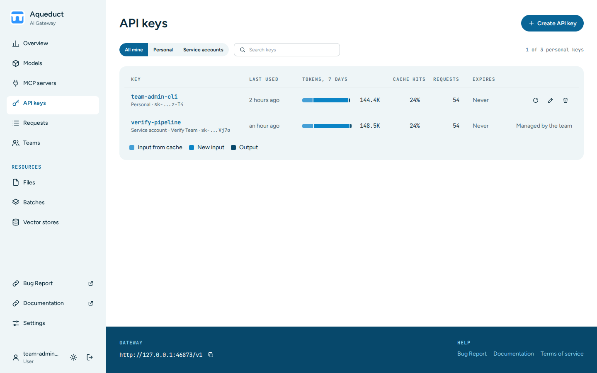
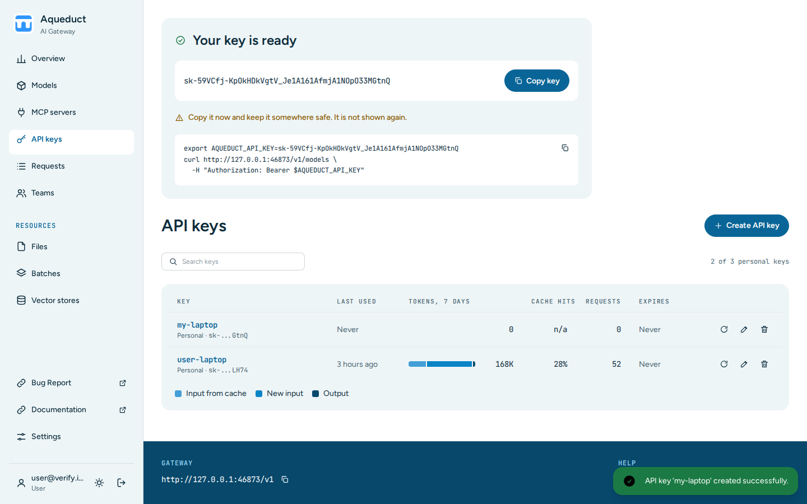
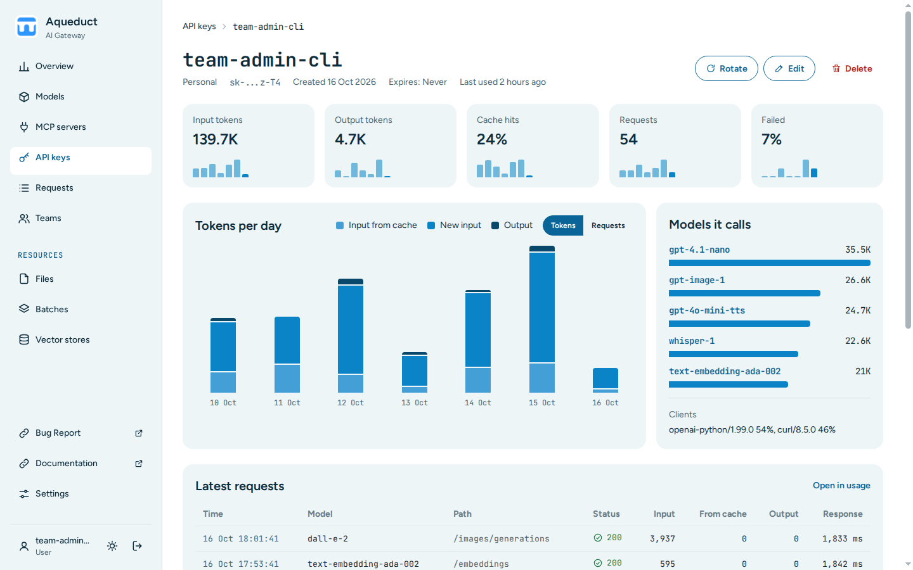

# API keys
{: .no_toc }

## Table of contents
{: .no_toc .text-delta }

1. TOC
{:toc}

---

An API key authenticates your requests to the gateway. A key works for every model that is available to you. Aqueduct passes requests through to OpenAI-compatible APIs, such as the OpenAI API or local models served by vLLM.

Choose **API keys** in the sidebar to open the list. Signing in opens the same page.

## Read the key list

The table shows your personal keys and the service account keys of your teams. Each row shows:

- **Key**: the name, the type (**Personal** or **Service account** with the team name), and the last four characters of the key.
- **Last used**: when the key last made a request.
- **Tokens, 7 days**: the tokens of the last seven days, split into input from cache, new input, and output.
- **Cache hits**: the share of input tokens served from the provider's cache.
- **Requests**: the requests of the last seven days.
- **Expires**: the expiry date, or **Never**.

If you are in a team with a service account, the tabs **All mine**, **Personal**, and **Service accounts** filter the table. The search box filters by key or team name.

The count above the table, such as `1 of 3 personal keys`, shows how many personal keys you have. Each user can have three personal keys. Service accounts do not count toward this limit.

## Create a key

1. Choose **Create API key**.
2. Enter a **Name**.
3. Optional: set an **Expiry**. Leave it empty for a key that never expires.
4. Choose **Create key**.

The **Your key is ready** panel shows the full key and a `curl` command that lists the models with it.

Choose **Copy key** and keep the key somewhere safe, such as a password manager. Aqueduct does not store the key and does not show it again. After this, the list shows only the last four characters.

If you already have three personal keys, **Create API key** is disabled. Delete a key to create another.

## Open a key

Choose a key's name to open its page. The page shows the key's last seven days:

- Totals for input tokens, output tokens, cache hits, requests, and failed requests.
- Tokens or requests per day.
- **Models it calls**, with the tokens per model.
- **Clients**, the user agents that used the key.
- **Latest requests**.
- **Limits**, the rate limits of the key and the models and MCP servers that are switched off for it.

**Open in Overview** opens the [Overview](usage.md) for this key alone.

A service account's name opens its [team page](teams.md#manage-service-accounts) instead.

## Rotate, edit, or delete a key

The buttons at the end of each row, and at the top of the key's page, change a personal key:

- **Rotate** replaces the key with a new one and shows it in the **Your key is ready** panel. The old key stops working immediately.
- **Edit** changes the name or the expiry.
- **Delete** opens a confirmation page. Choose **Confirm Delete** to delete the key.

An expired key no longer authenticates requests.

Service account rows show **Managed by the team**. Team admins rotate, edit, and delete them on the [team page](teams.md#manage-service-accounts).
