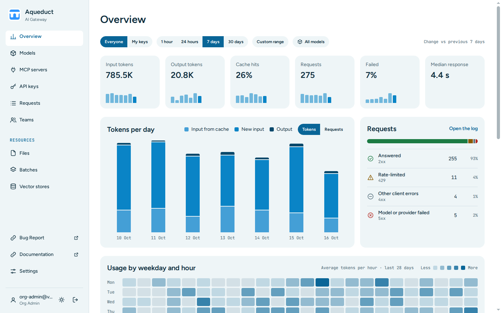

# Overview
{: .no_toc }

## Table of contents
{: .no_toc .text-delta }

1. TOC
{:toc}

---

The Overview page shows the token and request usage of the keys you can see. Choose **Overview** in the sidebar.

## Whose usage you see

- Users see their own keys and the service accounts of their teams.
- Org admins see every key of their organization. In the key menu, **All keys in** your organization and **My keys** switch between the whole organization and your own keys.
- Admins also choose an organization, or **All organizations**, in the organization select.

## Choose the time frame, the key, and the model

Choose **1 hour**, **24 hours**, **7 days**, or **30 days**. The page opens on **7 days**.

To show one model, choose it in **All models**. To show one key, open the key menu: it lists your own keys and your teams' service accounts. To find another key, type part of its name, or of its owner's e-mail address, in the search field of the menu and press Enter. The menu shows up to 20 matches. The [Requests](requests.md) page has the same filters.

The gateway keeps requests for a limited time, 30 days by default. If the time frame reaches back further, the page warns that older requests are missing.

## Read the page

- **Totals**: input tokens read from the cache, new input tokens, output tokens, requests, and the share of failed requests. Each total shows a bar per stretch of the time frame. **Failed** counts every `4xx` and `5xx` request.
- **Tokens per minute, hour, or day**: a chart of the time frame. **Tokens** and **Requests** switch what it counts.
- **Requests**: the requests split into answered (`2xx`), rate-limited (`429`), other client errors (`4xx`), and model or provider errors (`5xx`). **Open the log**, or a status group, opens the [Requests](requests.md) page with the same filters.
- **By model**: each model with requests in the time frame, with its tokens, cache hits, requests, median response time, and share. Choose a model to open the log for that model. When you see a whole organization or all organizations, over 24 hours or longer, the median is approximate, within 5%, and shows as **≈**.
- **Top keys**: the 10 keys that used the most tokens, with the columns of **By model** except the median. Choose a key to open its page. You can open your own keys and the service accounts of your teams. **View all keys** opens the [All keys](#see-the-usage-of-every-key) page with the same filters.
- **By organization**: the tokens of each organization, when an admin views all organizations.
- **Activity across your organization**: the average tokens per hour for each weekday and hour over the last 28 days. This section covers every user and key of the organization, whatever the time frame, key, and model you chose. When an admin views all organizations, it covers all organizations.

## See the usage of every key

The **All keys** page lists every key you can see that has requests in the time frame, 50 keys to a page. Choose **View all keys** under **Top keys** to open it. It has the same columns as **Top keys** and uses the same organization, key scope, model, and time frame filters, so its first rows are the **Top keys** of the Overview.

- **Tokens**, **Requests**, and **Name** sort the list. The list opens sorted by tokens.
- To find a key, type part of its name in the search field and press Enter. Org admins and admins can also type part of the owner's e-mail address.
- **Share** is the key's share of all tokens in the time frame, also while you search. The token bars are scaled to the key with the most tokens.
- **Previous** and **Next** move between pages. A change of filter, sort, or search returns to the first page.

## See usage per client user

If a service sends requests for many people with one key, it can send the [`user_id`](../api/index.md#sending-user_id-in-api-requests) field with each request. To see the usage per `user_id` value:

1. Open the key's page from **API keys**.
2. Choose **Open in Overview**.

The page then shows only this key, and **By user ID** replaces **Top keys**. **Show all keys** returns to all keys.
