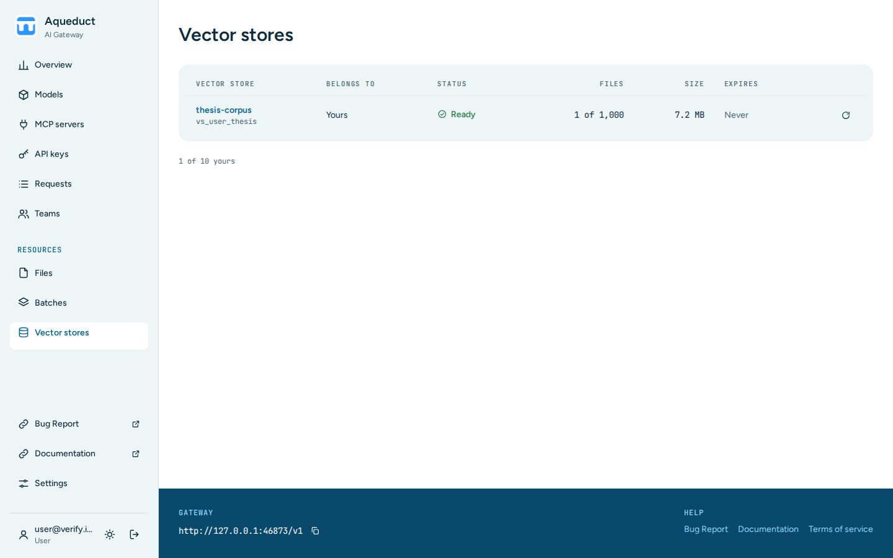

# Vector stores

The Vector stores page lists the vector stores that your keys created through the [Vector Stores API](../api/vector-stores.md). A vector store holds files that are split, embedded, and indexed for file search. Choose **Vector stores** under **Resources** in the sidebar.

The table lists the stores of your personal keys and of your teams' service accounts. Org admins see the stores of every key in their organization, and admins see those of the organization chosen in the sidebar, or of every organization. The newest stores come first, 50 per page. Choose **Next** and **Previous** under the table to move between pages. Each row shows:

- **Vector store**: the name and ID.
- **Belongs to**: **You**, the team name, or the email of the user who created the store.
- **Status**: whether the store is ready or still processing files.
- **Files**: the number of files.
- **Size**: the total size of the files.
- **Expires**: when the store expires, if it has an expiry.

The line under the table counts stores against the limits for your keys and for each team you belong to, as in `Vector stores: you 1/10 · Verify Team 1/50`.

## Open a vector store

Choose a store's name to open its page. The page shows the store's status, ID, owner, dates, file count, and size, and lists its **Files**, newest first and 50 per page. When the store has file batches, the page lists them with the status of each.

## Sync a vector store's status

Aqueduct stores a copy of each vector store's status. To load the current status from the provider, choose the sync button in the store's row, or **Sync status** on the store's page. You can sync the stores of your keys and of your teams. An org admin can also sync the stores of every team in the organization. Other users' stores are view-only.

To create a vector store or add files to it, use the [Vector Stores API](../api/vector-stores.md).
